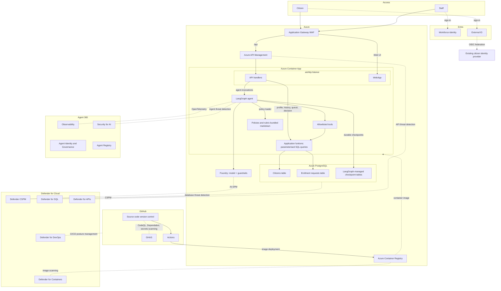
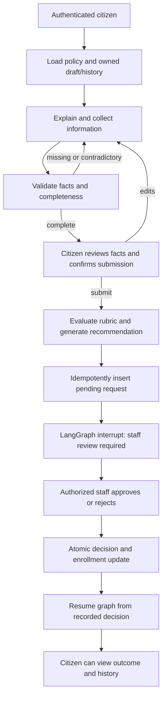

# Welfare Application Agent — Minimum Viable Product Plan

## 1. Purpose and success criteria

Demonstrate a welfare application assistant that reduces the time civil servants spend explaining policy, guiding applicants, and requesting missing information. The assistant prepares an assessment; an authorized staff member makes every approval or rejection decision.

The MVP must demonstrate:

1. A citizen signs in, asks eligibility/process questions, and receives answers grounded in bundled policy markdown.
2. The assistant collects required information, identifies omissions or contradictions, and requests clarification.
3. The citizen reviews and explicitly submits a complete application.
4. The application receives a rubric-based integer score from 0–10 and a markdown recommendation, then appears in the staff queue.
5. LangGraph pauses for human review and survives an application restart.
6. Staff approve or reject; the citizen sees the recorded decision and application history.
7. Citizens cannot access another citizen's data or invoke staff decision actions. The model cannot approve or reject applications.

**Scope:** one welfare scheme, one policy version per application, one language, one unified web application, one Python container, and one PostgreSQL server. Use synthetic citizen records for demonstrations. Real payments and live benefit entitlement changes are not part of the MVP.

## 2. Design decisions and clarifications

| Area | MVP decision |
|---|---|
| Agent responsibilities | Explain, collect, clarify, prepare recommendations, and hand off to staff. No autonomous final decisions. |
| Policy | Markdown files bundled into the image. No vector database, retrieval service, policy upload UI, or runtime policy editing. |
| Assessment | LangGraph orchestrates the assessment. Python applies explicit rubric rules to validated facts; the model explains the result in markdown. Do not let an unconstrained model invent a numeric score. |
| Business data | Two application-owned tables: `citizen` and `requests`. |
| Agent persistence | Separate LangGraph-managed checkpoint tables in a `langgraph` schema. These are not the staff approval queue and do not replace request records. |
| Database access | `psycopg` 3 with asynchronous connection pooling, parameterized SQL, and narrow application functions. Azure's PostgreSQL management SDK is not the SQL query driver. |
| UI/runtime | `aiohttp` serves simple HTML, CSS, JavaScript, authentication callbacks, and API handlers in one container. No separate frontend deployment. |
| Human review | Queue in PostgreSQL plus a durable LangGraph `interrupt()`; staff decision API is not an LLM tool. |
| Identity | Staff use an Entra workforce tenant. Citizens use an Entra External ID external tenant federated to the existing citizen OIDC provider. |
| PostgreSQL protection | Use Defender for **open-source relational databases**, not Defender for SQL, for supported PostgreSQL Flexible Server deployments. |
| Container protection | Enable applicable ACR image assessment and Defender for Containers features, but verify Container Apps coverage explicitly; do not assume Kubernetes runtime protections apply to Container Apps. |

## 3. Architecture



### Traffic and hosting

- Expose one public HTTPS hostname. Application Gateway routes `/api/*` to APIM and UI/authentication routes to the container application.
- Browser JavaScript calls same-origin `/api/*`. Every business action, including UI button actions, goes through APIM; serving the UI must not create an alternate unprotected business API.
- Select APIM and Container Apps networking options that support this routing. Restrict backend access to the intended gateway paths using private/internal ingress and network controls. Direct calls to APIM or Container Apps must not bypass WAF/API controls.
- The shared container serves both UI and API routes. Apply route-specific authorization and validate any gateway assertion independently; never trust client-supplied identity headers.
- Use a VNet-connected runtime and private PostgreSQL connectivity. Require database TLS with certificate verification.
- Start with one active container revision and one replica for the demonstration. Serialize mutations per application/thread with database-backed locking; this also protects against concurrent requests in one process. Pause/resume uses persisted state, not a resident Python task.
- Use bounded synchronous agent invocations with a non-streaming JSON response first. Staff queue refresh uses polling. No message broker or WebSocket infrastructure is required.
- Set model call deadlines, retry limits, tool-call limits, and graph recursion limits. Keep API/gateway timeouts aligned. On timeout, return a recoverable error and allow retry with the same operation ID.

## 4. Identity and authorization

### Sign-in

Use authorization-code flow with PKCE and validated `state`/`nonce`. Configure separate workforce and external-tenant app registrations and explicit callback routes. Verify the citizen provider's discovery metadata, issuer, claim mapping, and federation prerequisites before the Azure pilot. Federation proves account authentication, not welfare eligibility or real-world identity assurance.

For this MVP, browser JavaScript keeps short-lived API access tokens in memory rather than local storage and sends `Authorization: Bearer ...`. Do not send ID tokens as API credentials. Reauthenticate when needed instead of adding refresh-token storage complexity. If cookies are used for login/session handling, mark them Secure, HttpOnly, and SameSite and add CSRF protection to cookie-authenticated mutations.

APIM and application middleware validate signature, issuer, audience, expiry, and the required scopes/roles. Configure explicit issuer/audience pairs for both identity tenants; never accept arbitrary tenants. Decide supported API registration/token-audience arrangements during the identity integration spike rather than assuming both tenants issue identical tokens.

### Access rules

| Actor | Allowed actions |
|---|---|
| Citizen | Read own profile/history, chat on own application, review own draft, submit own application, view own outcome. |
| Workforce user with `Welfare.Reviewer` role | Read pending queue and request detail, approve/reject a pending request with a reason. |
| Workforce user without reviewer role | No staff queue or decision access. |
| Model/tool call | Only allowlisted citizen-scoped reads and validated draft actions. Cannot supply identity, enumerate citizens, or invoke decision functions. |

Map a validated external-token `(issuer, subject)` pair to a generated internal citizen UUID. Do not use email as the identity key. The UUID replaces an NRIC/social-security identifier in the demo, but is not itself an access credential.

Derive `citizen_id` and actor identity from authenticated server context, never from model arguments. Check ownership for every application, request, and thread lookup. Staff roles come only from the configured workforce issuer. Hidden UI controls are not authorization.

## 5. Policy and assessment

### Policy files

Use a small directory such as:

```text
policies/
  welfare-demo-v1.md
```

Each policy includes:

- Policy identifier, version, effective date, and a prominent demonstration-only label.
- Plain-language eligibility criteria and application instructions.
- Stable criterion identifiers, required fields, validation rules, and evidence expectations.
- A fenced, machine-readable JSON rubric inside the markdown, containing the numeric thresholds and scoring rules.
- Examples, exceptions, and instructions to refer ambiguous cases to staff.

Parse and validate the rubric on startup. The markdown is the policy artifact; the structured block prevents maintaining a separate, conflicting set of thresholds. Reject invalid, ambiguous, or out-of-range scoring rules. Preserve the exact policy content hash with each submitted assessment and keep the corresponding image/policy artifact available for review.

Load the short policy directly into model context. Policy answers and recommendations reference the policy version and criterion/section identifiers. User-provided text cannot override policy, change scoring weights, or become trusted system instructions.

### Information collection

Demonstration fields may include household size, monthly household income and currency, residency category, age, dependants, and a declaration that the information is accurate. The policy defines the actual required set; these examples are not government requirements.

- Accept structured form entries or model-extracted candidate facts from chat.
- Validate types, ranges, currency/period, missing values, and contradictions in Python.
- Ask targeted clarification questions; do not infer missing income, residency, or household members.
- Show extracted facts to the citizen for confirmation before submission.
- MVP evidence is self-declared, with staff verification explicitly indicated. No uploads or OCR. If the selected scheme requires documents, the demonstration is a simulated application intake, not a production-complete claim.

### Scoring and recommendation

The rubric must define an integer score in the inclusive range 0–10 and its meaning. Use **higher score = greater priority under this demonstration rubric**; do not imply that it is a probability, certainty measure, or legal entitlement.

Store separately:

- Eligibility result: `eligible`, `ineligible`, or `needs_review`.
- Criterion-level outcomes and supplied fact references.
- Numeric score and its component breakdown.
- Suggested staff action and known verification needs.

For missing required facts, do not score or enqueue; continue clarification. For a complete application that fails eligibility, still submit to human review with an ineligibility recommendation. Route policy ambiguity or non-required evidence uncertainty to `needs_review`; use a policy-defined score or leave the score null when no valid score can be produced, with a visible reason. Never fabricate a score merely to fill a column.

The model writes a recommendation from the validated assessment using a fixed template: summary, criterion findings, score explanation, verification gaps, and suggested staff action. It may not alter computed outcomes. If generation fails, use a deterministic markdown template containing the real assessment, not a fabricated model response.

Queue order defaults to oldest submission first, with score displayed for staff consideration. Automated ranking must not silently deprioritize applicants or substitute for policy-approved triage.

## 6. Data model

### Table: `citizen` - fictitious citizens list

| Column | Type | Purpose |
|---|---|---|
| `citizen_id` | UUID primary key | Internal identifier. |
| `identity_issuer` | TEXT | Validated external token issuer. |
| `identity_subject` | TEXT | Validated external token subject. |
| `display_name` | TEXT | Optional UI label. |
| `enrollment_status` | TEXT | `active`, `not-applied`, or `rejected`. |
| `created_at`, `updated_at` | TIMESTAMPTZ | Record timestamps. |

Constraints: unique `(identity_issuer, identity_subject)` and a status check constraint. Do not store national identifiers for the demo.

### Table: `requests` - business request history

| Column | Type | Purpose |
|---|---|---|
| `request_id` | UUID primary key | Server-generated application/request ID. |
| `citizen_id` | UUID foreign key | Links to `citizen`. |
| `thread_id` | UUID unique | Identifies the durable LangGraph application thread. |
| `status` | TEXT | `pending`, `approved`, or `rejected`. |
| `application_data` | JSONB | Immutable confirmed submission snapshot. |
| `policy_id`, `policy_version`, `policy_hash` | TEXT | Policy provenance. |
| `assessment` | JSONB | Eligibility result, criterion outcomes, score breakdown, and assessment/model metadata. |
| `score` | INT nullable | 0–10 when assessable; null only for explicit assessment exceptions. |
| `recommendations` | TEXT | Markdown for staff, rendered safely. |
| `reviewer_issuer`, `reviewer_subject` | TEXT nullable | Authenticated deciding staff member. |
| `decision_reason` | TEXT nullable | Mandatory on approval/rejection. |
| `decision_at` | TIMESTAMPTZ nullable | Decision timestamp. |
| `review_resume_pending` | BOOLEAN | Durable signal that graph must reconcile with a recorded decision. |
| `events` | JSONB | Append-only application events within this row for the MVP. |
| `submitted_at`, `updated_at` | TIMESTAMPTZ | Timestamps. |

Constraints and indexes:

- Status check, nullable score range check, and foreign key enforcement.
- Final status requires reviewer identity, reason, and decision timestamp.
- Unique partial index on `citizen_id` where `status = 'pending'`: one pending application per citizen for this single-scheme MVP.
- Index `(status, submitted_at)` for the staff queue and `(citizen_id, submitted_at)` for history.
- Every submission creates a new record. Never overwrite a prior application's facts or assessment with a reapplication.

Draft facts and conversation state live in checkpoints until submission. Generate `request_id`/`thread_id` at draft creation, and use the stable request ID for an idempotent submission insert. A pending request is not an enrollment state: the citizen remains `not-applied` until a decision, or retains the previous enrollment status during reapplication. Display pending status from `requests`.

Approval changes enrollment to `active`. Rejection changes a non-active citizen to `rejected`; rejection of a new request must not revoke an existing active enrollment. Active citizens cannot start duplicate enrollment applications in the MVP. Renewal, benefit termination, and multiple schemes are out of scope.

### LangGraph persistence

Use `langgraph-checkpoint-postgres` and its asynchronous PostgreSQL checkpointer. Run its setup/migrations as a controlled deployment step. Let the library manage its checkpoint tables.

Checkpoint state includes bounded conversation history, validated draft facts, missing fields, application revision, policy version, submission identifiers, and the current workflow step. Resolve thread IDs through owned server records/state; never let a client choose an arbitrary checkpoint thread. Apply retention to checkpoints as well as business data.

## 7. Workflow and human-in-the-loop control



### Submission

1. Authenticate and check citizen ownership; acquire the application/thread lock.
2. Revalidate the confirmed draft revision and policy version. Submission is an explicit UI/API operation, never triggered by a conversational claim that approval was granted.
3. Run the deterministic assessment and generate or template the recommendation.
4. Insert the pending request idempotently; freeze the submission facts and assessment. Append a submission event in the same transaction.
5. In a separate node, call `interrupt()` with the request identifier and review summary. No final enrollment decision has occurred.
6. Return the request status to the citizen. Staff read the business queue, not serialized checkpoint blobs.

A checkpoint write and business transaction are not automatically one atomic transaction. On retry/restart, reconcile the request record with checkpoint state using the stable request/thread IDs; an existing submission must not be scored or inserted again.

### Staff decision

1. Validate workforce issuer, reviewer role, request status, decision, and required reason.
2. In a database transaction, lock the request row, change `pending` to the chosen final status, record reviewer/reason/time, update enrollment according to the rules above, append the event, and set `review_resume_pending = true`.
3. Commit. The business decision is now authoritative, even if the model or graph is unavailable.
4. Resume the correct graph with `Command(resume=...)` using the server-read recorded decision and the same `thread_id`. The post-interrupt node reads the decision from the database rather than trusting a client resume payload.
5. Clear `review_resume_pending` after graph completion. A small reconciliation routine in the same container retries unfinished resumes on startup and periodically, with database locking and idempotency. No separate worker service is needed.

A repeated identical decision returns the existing outcome; a conflicting decision returns `409 Conflict`. Serialize graph operations per thread. Code before an `interrupt()` can replay on resume, so keep side effects in separate idempotent nodes and do not wrap interrupts in broad exception handlers. Citizens cannot resume a staff-review interrupt through the chat endpoint.

## 8. Application functions and agent tools

All SQL uses placeholders and bound parameters. Never expose raw SQL, table names, or arbitrary query execution to the model. Validate tool arguments with typed schemas; cap returned history and payload sizes.

| Function | Exposed to model? | Authorization and behavior |
|---|---|---|
| `get_my_profile()` | Yes | Identity injected from server context; returns minimal owned data. |
| `get_my_request_history(limit)` | Yes | Citizen-scoped, bounded history; no unrelated records. |
| `get_current_policy()` | Yes | Returns the bundled, pinned policy and section IDs. |
| `save_draft_fields(fields, expected_revision)` | Yes | Validates allowlisted fields; cannot alter identity, decisions, score, or policy. Draft persists through graph checkpointing. |
| `evaluate_application(validated_facts, policy_version)` | Deterministic graph node | Returns the real rubric result; not an open-ended model-written assessment. |
| `submit_application(confirmed_revision)` | No | Citizen API invokes controlled graph transition after explicit confirmation. |
| `get_my_request(request_id)` | Yes | Must check ownership; include only citizen-appropriate outcome fields. |
| `list_pending_requests(cursor, limit)` | No | Staff API only. |
| `get_request_for_review(request_id)` | No | Staff API only. |
| `record_staff_decision(request_id, decision, reason)` | No | Staff-only atomic transaction; not registered as an agent tool. |

Use one shared application-function layer for tools and API handlers. Separate migration credentials from runtime database credentials. Within this single-container trust boundary, enforce citizen scope and reviewer permissions in server code and deny DDL to the runtime role. A separate tool service or fine-grained database role isolation can follow after the MVP.

## 9. UI and API surface

### Unified UI

- **Citizen view:** policy/process help, chat, required-information checklist, editable facts, confirmation/submit button, current request status, and request history.
- **Staff view:** pending queue, request detail, confirmed facts, criterion results, score, sanitized recommendation markdown, and approve/reject controls with a mandatory reason.
- Show an AI-assistance notice and explain that staff make final decisions. Do not promise approval, a payment date, or an entitlement.
- Use plain language, labeled form controls, keyboard navigation, and a visible path to contact staff when the agent cannot help.
- Render markdown with raw HTML disabled and sanitize the result. Escape citizen fields, restrict link schemes, and apply a Content Security Policy.

### Minimal endpoints

| Method and route | Purpose |
|---|---|
| `GET /` | Unified UI shell. |
| `GET /auth/citizen/login`, `GET /auth/staff/login` | Start the appropriate sign-in flow. |
| `GET /auth/citizen/callback`, `GET /auth/staff/callback` | Validate and complete authentication. |
| `GET /api/me` | Return validated actor role and own citizen profile where applicable. |
| `POST /api/applications` | Create or return the citizen's owned draft and server-assigned IDs. |
| `POST /api/applications/{application_id}/messages` | Invoke the collection/help graph on an owned draft. |
| `GET /api/applications/{application_id}` | Retrieve owned draft, checklist, revision, and workflow status. |
| `POST /api/applications/{application_id}/submit` | Confirm a specific revision and enqueue assessment idempotently. |
| `GET /api/requests`, `GET /api/requests/{request_id}` | Citizen's own submitted history/detail. |
| `GET /api/staff/requests?status=pending` | Paginated reviewer queue. |
| `GET /api/staff/requests/{request_id}` | Reviewer detail. |
| `POST /api/staff/requests/{request_id}/decision` | Record approve/reject with reason and reconcile graph. |
| `GET /health/live`, `GET /health/ready` | Runtime probes; disclose no secrets or citizen data. |

Use operation IDs for mutating calls, revision checks for draft edits/submission, request-body limits, and per-user API rate limits. Return consistent JSON errors and correlation IDs. Readiness checks policy validity and database connectivity; a temporary model outage should not prevent staff from deciding already queued requests.

## 10. Security, privacy, and operations

### Baseline controls

- Managed identity for ACR image pull and supported Foundry/database authentication. For PostgreSQL Entra authentication, provision the database principal and handle short-lived token renewal when opening pooled connections.
- If identity integration requires secrets, store them in Key Vault and expose them through supported secret references. Never place secrets in the image, policy files, source, logs, or GitHub workflow variables in plaintext.
- TLS on every network hop, private database connectivity, least-privilege Azure RBAC, and restricted backend ingress.
- WAF protections, APIM JWT validation and rate limiting, and application-side ownership/role checks. Gateway protection is not a substitute for endpoint authorization.
- Foundry content filters and applicable prompt-shield/guardrail settings on the selected model endpoint. Treat guardrails as defense in depth, not proof of correct eligibility decisions.
- Tool allowlisting and fixed policy loading prevent arbitrary database/file access and policy modification. Treat citizen messages and historic recommendations as untrusted data.
- Logs contain correlation IDs, operation types, latency, error category, and minimal pseudonymous identifiers. Do not log complete conversations, access tokens, identity-provider secrets, or application facts by default.
- Record policy/model version, verified fact snapshot, assessment outputs, and reviewer rationale—not private model reasoning or chain-of-thought.
- Set a documented pilot retention period and deletion procedure for records, checkpoints, traces, and backups before collecting real personal data. PostgreSQL backups and restore procedures must be tested.
- Fail safely on policy/model/database errors: no invented facts, unauthorized status changes, or automatic rejection. Offer staff assistance when blocked.

### Defender and code assurance mapping

| Component | Protection/posture control | Pilot verification |
|---|---|---|
| Azure resources | Defender CSPM | Review recommendations, exposure, permissions, and supported AI posture assessments. |
| Foundry model endpoint | Applicable Defender AI/Foundry threat protection and Foundry guardrails | Confirm exact plan, endpoint/model support, region, preview status, and an observable test alert where supported. |
| PostgreSQL Flexible Server | Defender for open-source relational databases | Confirm supported coverage and onboarding; Defender for SQL is not the correct PostgreSQL plan. |
| ACR/container image | Supported Defender for Containers image vulnerability assessment | Confirm image scan results; document Container Apps runtime protection gaps rather than assuming AKS coverage. |
| APIM | Defender for APIs where supported | Confirm selected APIM tier, API onboarding, and monitoring prerequisites. |
| GitHub | Defender for Cloud DevOps security integration | Connect the repository and review supported posture findings. |
| Repository | CodeQL, Dependabot, secret scanning and push protection | Confirm repository/org licensing and enable the appropriate GitHub security products/features. |

Enable these services for the Azure pilot where supported and budgeted. They need not be simulated in a local logic demonstration. Defender, WAF, and content filters do not establish legal compliance or prevent every prompt attack.

### Minimal observability

Use structured application logs and Azure Monitor/Application Insights as appropriate. Track policy-answer quality, missing-field loops, completed submissions, queue age, staff handling time, agent latency/cost, errors, retry/reconciliation failures, and unauthorized access attempts. Expose reconciliation failures to operators; do not hide them behind a successful submission message.

## 11. Repository, container, and deployment

### Suggested repository layout

```text
app/
  main.py                 # aiohttp startup, routes, middleware, lifecycle
  auth.py                 # workforce/external identity validation
  api.py                  # citizen and staff handlers
  agent.py                # LangGraph nodes, interrupts, reconciliation
  tools.py                # narrow citizen-scoped tool adapters
  services.py             # shared business operations and transactions
  db.py                   # psycopg pool and parameterized SQL
  policy.py               # markdown loader and deterministic rubric evaluator
  schemas.py              # typed payloads and validation
  templates/              # one unified HTML interface
  static/                 # CSS and small JavaScript client
policies/
  welfare-demo-v1.md
migrations/
tests/
  unit/
  integration/
  evaluation/
infra/                    # Bicep for the Azure pilot
.github/workflows/
Dockerfile
compose.yaml              # local app and PostgreSQL
pyproject.toml
requirements.lock
.env.example              # names/placeholders only
README.md
plan.md
```

Core dependencies: `aiohttp`, LangGraph, `langgraph-checkpoint-postgres`, `psycopg`/pool, typed schema validation, an OIDC/token validation library, a supported Foundry model client, and safe markdown rendering. Pin compatible versions after the integration spike; use the same database driver family for business operations and checkpoints.

Build a non-root container with a read-only policy directory, no development tools/secrets, and graceful shutdown of HTTP/model/database clients. Bind the configured application port and provide liveness/readiness probes.

### GitHub Actions

1. Pull request: lint/type checks, unit tests, PostgreSQL integration tests, CodeQL, dependency checks, and secret scanning.
2. Protected branch: build the image, generate an SBOM where feasible, push to ACR, and review image vulnerability results. Block critical exploitable findings using an explicit policy.
3. Authenticate GitHub Actions to Azure through OIDC workload federation, not long-lived Azure credentials.
4. Deploy/update infrastructure separately as needed. Run business/checkpointer migrations with controlled migration permissions.
5. Deploy Container Apps by immutable image digest. Smoke-test UI routing, API authorization, database access, model access, queue creation, and durable human review using synthetic accounts.
6. Use GitHub environment approval for pilot deployment. Keep the prior image digest and compatible policy artifact for rollback. Use backward-compatible migrations; never silently resume old threads against a changed rubric or incompatible graph.

No Kubernetes, separate agent server, distributed queue, document store, or additional citizen/staff containers are required.

## 12. Implementation sequence

| Phase | Deliverable | Exit check |
|---|---|---|
| 1. Integration spike and policy | Confirm identity/token audiences, Foundry model access, PostgreSQL checkpointer, network/tier compatibility, and one demo policy. | Both actor types can authenticate; model call and checkpoint write/read work; rubric validates. |
| 2. Data and direct APIs | Migrations, authorization middleware, shared SQL functions, profile/history/queue/decision APIs. | Ownership isolation and atomic/idempotent decisions pass integration tests. |
| 3. Citizen agent | Policy explanation, validated fact collection, confirmation, deterministic scoring, recommendation, submission, and interrupt. | Complete and incomplete scenarios follow the correct paths. |
| 4. Unified UI and recovery | Citizen/staff screens, safe markdown, graph resume, restart reconciliation. | Full approve/reject demonstrations pass, including restart and duplicate calls. |
| 5. Azure pilot | Bicep, container pipeline, WAF/APIM routing, observability, and supported Defender controls. | Deployed smoke tests pass; bypass checks and scan/posture evidence are recorded. |

Build and exercise the local logic before adding the Azure perimeter. The Azure pilot retains the proposed service boundaries; the local demo uses the same application/checkpointer code with PostgreSQL and clearly labeled development-only identity fixtures. Never enable fixture authentication in the Azure pilot.

## 13. Verification and demonstration

### Automated acceptance tests

| Scenario | Required outcome |
|---|---|
| Policy/process question | Grounded answer with correct policy references; no unsupported entitlement claim. |
| Missing or invalid facts | Targeted clarification; no score, pending request, or enrollment update. |
| Conflicting chat facts | Confirmation required; no silent overwrite of a confirmed submission. |
| Complete eligible application | Correct rubric score, criterion results, markdown recommendation, exactly one pending record, and human-review interrupt. |
| Complete ineligible application | Staff queue receives an ineligibility recommendation; no automatic rejection. |
| Ambiguous policy/evidence | Visible `needs_review` outcome; null score only with an explicit valid exception reason. |
| Score boundaries | Exact policy thresholds and inclusive 0–10 constraints are tested. |
| Retry/double-click submission | One business request with unchanged policy/fact/assessment snapshot. |
| Concurrent staff decisions | One committed outcome; conflicting decision rejected; no lost enrollment update. |
| Restart during collection/review | Owned draft and paused thread can continue from PostgreSQL. |
| Failure between request insert and interrupt | Reconciliation reaches staff review without duplicate submission. |
| Failure after decision commit but before resume | Staff/citizen see the true final status; reconciliation finishes the graph once. |
| Citizen submits another citizen/thread UUID | Access denied without data leakage. |
| Citizen or non-reviewer invokes decision API | Access denied, including direct backend/bypass attempts. |
| Prompt asks for approval, SQL execution, or policy override | No forbidden tool/action or unauthorized state change. |
| Malicious markdown/HTML | No script execution or unsafe rendered links. |
| Model outage | Existing staff reviews still work; collection fails explicitly; recommendation uses the real deterministic template if available. |
| Rejected reapplication | Prior request history remains intact; existing active enrollment is not revoked. |

Use deterministic mocks for fast unit tests, but run end-to-end pilot tests against real PostgreSQL checkpoints and the selected Foundry model. Do not present mocked model/network responses as deployment evidence.

### Foundry evaluation and AI red teaming

Create a small, version-controlled synthetic evaluation set with expected policy answers, required fields, criterion results, scores, and staff-routing outcomes. Evaluate groundedness, correct clarification, rubric fidelity, unauthorized-action resistance, and sensitive-data leakage. Include paraphrased financial facts, attempts to change scoring rules, fake staff instructions, cross-citizen access, and abusive content. Use supported Foundry evaluation/red-teaming facilities or SDKs for the custom LangGraph endpoint and retain results with the image/policy version.

Compare explanations and staff usability, not just whether the model returned well-formed text. Human review is a real control, not a rubber stamp; staff should see the original confirmed facts alongside the recommendation. Measure staff time saved against a manual demonstration baseline before claiming productivity gains.

### Demonstration script

1. Citizen asks who qualifies and how to apply.
2. Citizen supplies incomplete household facts; the assistant identifies the missing income information.
3. Citizen completes and confirms the facts; the assistant scores and submits the application.
4. Staff opens the queue and reviews the rubric findings and recommendation.
5. Restart the container while review is pending; show that the queue and interrupt survive.
6. Staff approves with a reason; show `active` enrollment and the persisted approved request.
7. With another synthetic citizen, demonstrate rejection, history lookup, and blocked cross-citizen/staff-action access.

**Completion evidence:** passing test report, deployed image digest, policy version/hash, evaluation output, route/auth smoke-test results, persisted request/decision records, restart-resume evidence, and security findings with acknowledged coverage gaps.

## 14. Out of scope and pilot gates

Out of scope: money disbursement, document uploads/OCR, appeals workflow, multi-scheme enrollment, policy authoring UI, model-generated policy, identity proofing, automated fraud decisions, multilingual support, autonomous approvals, and high-availability/load-test guarantees.

Before a pilot involving real citizens, obtain policy-owner approval of the rubric and score meaning, privacy/security review, identity assurance and federation agreement, approved retention/data residency, accessible fallback and appeal information, staff accountability procedures, and verified service/model/Defender availability in the chosen region. A synthetic demo is not evidence that these gates have been met.

## 15. Technical references

- [Entra External ID: custom OIDC federation](https://learn.microsoft.com/en-us/entra/external-id/customers/how-to-custom-oidc-federation-customers)
- [LangGraph interrupts and replay semantics](https://docs.langchain.com/oss/python/langgraph/interrupts)
- [LangGraph persistence](https://docs.langchain.com/oss/python/langgraph/persistence)
- [Defender for Databases overview](https://learn.microsoft.com/en-us/azure/defender-for-cloud/defender-for-databases-overview)
- [Foundry compliance and security controls](https://learn.microsoft.com/en-us/azure/ai-foundry/control-plane/how-to-manage-compliance-security)

Validate pricing, region support, service tiers, API compatibility, and preview/GA status during the integration spike. These references inform the architecture; they do not guarantee that every security capability covers the selected pilot configuration.
