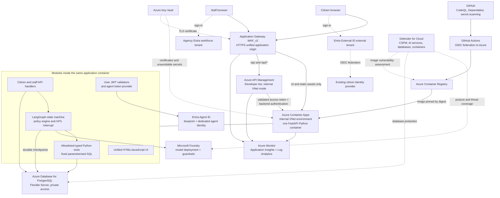
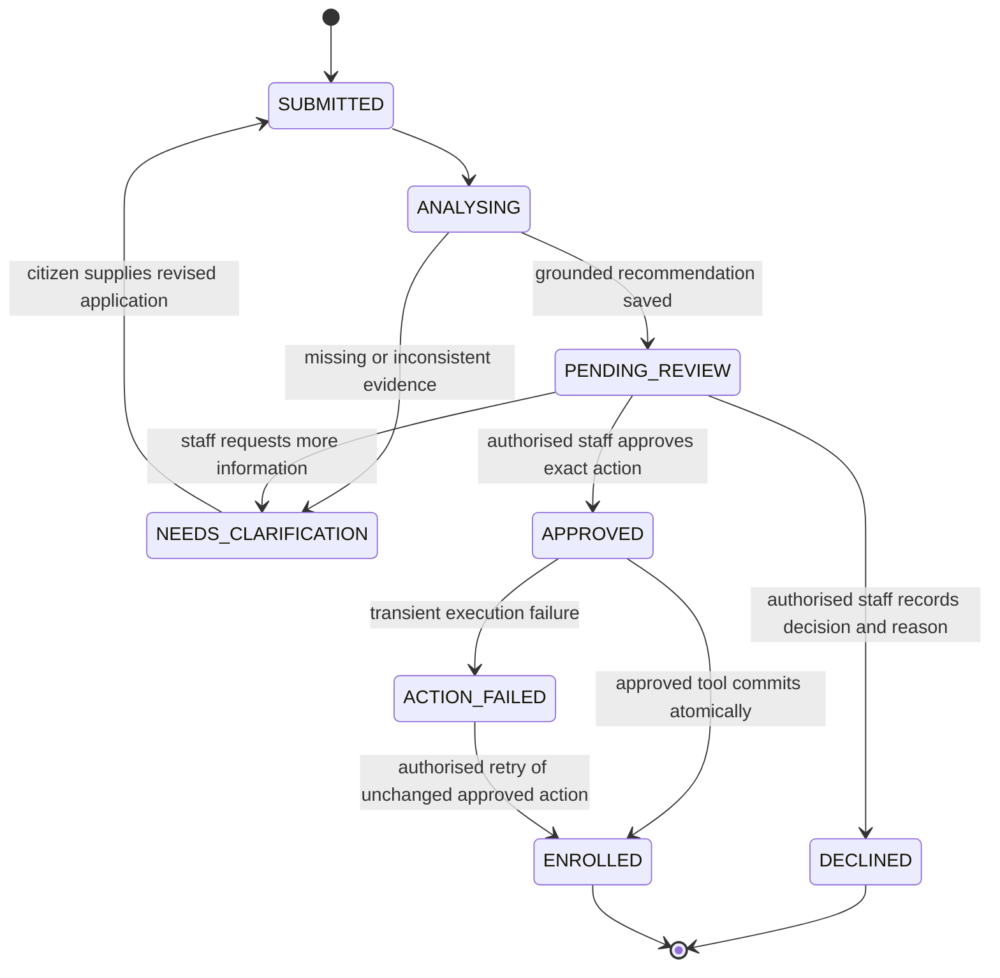

# Welfare application review agent — Azure minimum viable pilot

**Document status:** Architecture and implementation plan; not a deployed application.  
**Reference check:** 1 November 2026.  
**Scope:** One welfare programme, synthetic citizen records, one unified web application, one Python application container, and mandatory civil-servant approval before enrolment.  
**Core principle:** The agent assists case review; it does not exercise statutory decision-making authority or initiate payments.

## 1. Pilot outcome and boundaries

Demonstrate this complete journey:

1. A citizen signs in using their existing identity provider federated through Microsoft Entra External ID.
2. The citizen submits a structured welfare request and can view only their own application status.
3. A LangGraph workflow retrieves the case, checks existing enrolment, evaluates explicit policy rules, and uses a Foundry model to produce a grounded case summary and recommendation.
4. The workflow persists its state and interrupts for staff review. No enrolment happens while it is paused.
5. An authorised civil servant reviews the evidence and exact proposed action, then approves, declines, or requests clarification.
6. After approval, the workflow resumes and invokes a tightly scoped enrolment tool. PostgreSQL records enrolment and the completed request atomically.
7. The citizen sees the result; an auditor can reconstruct the application, recommendation, approval, and executed action.

### Included and deliberately excluded

| Included in the pilot | Excluded from the pilot |
|---|---|
| One programme and a versioned, fictional demonstration policy | Real statutory eligibility policy until formally approved |
| Structured application form and a short optional narrative | Document uploads, OCR, external evidence retrieval, and vector search |
| Staff work queue, review screen, and citizen status screen | Separate staff and citizen applications |
| One graph with a small allowlisted tool set | Multi-agent delegation, open-ended web browsing, arbitrary code execution |
| Enrolment into a pilot database register | Bank integration, payment scheduling, actual funds disbursement |
| Human decisions with recorded reasons | Automatic denial, suspension, deletion, or benefit reduction |
| Restart-safe checkpoints and retry-safe writes | Production high availability, large-volume scaling, and disaster-recovery commitments |

The `welfare_enrolment` table represents the pilot disbursement-system register, not a production finance system. If an existing disbursement system must be called later, add a separate approved integration with transactional outbox and idempotent delivery; do not pretend a local database insert is successful external enrolment.

## 2. Architecture



**Foundry is the model and safety platform, not the graph runtime.** LangGraph runs in Container Apps. This design does not add Foundry Agent Service, a LangGraph hosted service, AKS, a tool-server microservice, or an identity sidecar by default. Foundry-hosted-agent controls must not be assumed to govern this external runtime automatically.

### Minimal Azure resource set

| Resource | Pilot selection and purpose |
|---|---|
| Resource group | One dedicated pilot resource group; agency policy and budget applied |
| VNet and private DNS | Separate subnets for Application Gateway, internal APIM, Container Apps, and PostgreSQL; service-specific delegation and platform-required networking |
| Application Gateway | WAF_v2, public HTTPS listener, managed rules in prevention mode after benign-flow testing |
| API Management | **Developer tier, internal VNet mode**; supported for this topology, but unsuitable for production SLA expectations [S2] |
| Container Apps | One internal VNet environment; one application with one Python container; minimum and maximum replicas initially one |
| Container Registry | Basic for the smallest image-registry pilot; disable admin credentials and use identity-based push/pull |
| Foundry | One account/project and one supported Azure-hosted chat-model deployment; model quota and data-residency constraints checked first |
| PostgreSQL | One Flexible Server and one database, private VNet access; smallest suitable supported compute tier, Entra authentication, backups |
| Key Vault | Gateway certificate and any unavoidable federation/client credentials; no credentials baked into the image |
| Monitoring | One Log Analytics workspace and Application Insights integration |
| Defender for Cloud | Enable relevant CSPM and workload plans; verify actual resource coverage rather than merely plan toggles |
| Entra | Workforce registrations, External ID registrations/federation, and a separately provisioned agent blueprint/identity |

Use an approved Azure commercial region for the demonstration. An agency deployment in Azure Government or another sovereign cloud requires a separate model, identity, evaluation, and Defender availability check. Government ownership does not imply all commercial-cloud capabilities exist in a sovereign cloud.

### Network and routing details

- Publish one origin, for example `https://welfare-pilot.example.gov`. The name is illustrative, not a provisioned domain.
- Gateway routes `/api` and `/api/*` to APIM. Routes `/`, login callback pages, and `/assets/*` go directly to the same Container App's UI endpoints.
- APIM forwards the registered API paths to the Container App without recursively routing back through the public gateway.
- Use Container App **environment-level internal visibility**, with app ingress reachable from the VNet. App ingress limited only to other Container Apps would prevent Application Gateway/APIM from reaching it.
- Configure private DNS, backend hostname/SNI, HTTPS certificate validation, and custom health probes for both APIM and Container Apps [S1, S2]. Do not blindly copy a tutorial's external developer-portal/management exposure.
- Do not expose the APIM developer portal or management endpoint through the gateway. Container App and PostgreSQL must have no public data ingress.
- UI routing is not an API backdoor: FastAPI API endpoints require both the end-user token and APIM backend authentication. Use APIM-to-backend mTLS with a narrowly distributed certificate, or another verified supported gateway-auth mechanism. A spoofable `X-From-APIM` header is insufficient.
- Limit Container App ingress to approved gateway/APIM sources using supported ingress restrictions, and test the effective rules. Keep platform health probes narrowly scoped.
- PostgreSQL accepts database traffic only from approved runtime/migration paths. Preserve required Entra/Graph outbound connectivity for authentication [S7].
- For the synthetic pilot, Foundry's authenticated HTTPS endpoint may remain public with least-privilege access; document this exception. Private endpoints and controlled egress are prerequisites for sensitive live data where agency policy requires them.
- ACR Basic does not provide the private-endpoint topology of higher tiers. If private registry access is mandatory, use an appropriate higher tier and a network-connected build runner rather than claiming Basic is fully private.

## 3. Unified application and identity design

### One container, one listener

Use FastAPI with Uvicorn on port `8080`. The container contains:

- Static HTML/JavaScript for the citizen and staff experiences, using MSAL browser authentication.
- Separate citizen and staff API routers.
- JWT validation and authorisation middleware.
- LangGraph graph, policy evaluator, and fixed SQL tool wrappers.
- PostgreSQL pools and a durable graph checkpointer.
- Foundry model client, tracing, readiness/liveness endpoints, and a bounded recovery task.

No additional UI server or runtime container is required. A small static UI avoids a separate Node.js runtime. UI visibility depends on verified identity, but **all access controls are enforced again on the server**.

### Two authorities, explicitly separated trust

| Concern | Staff | Citizens |
|---|---|---|
| Authentication authority | Agency Entra workforce tenant | Separate Entra External ID external tenant |
| Upstream identity | Agency staff identity | Existing citizen IdP through custom OIDC federation |
| Client/API registration | Staff SPA and staff API registrations in workforce tenant | Citizen SPA and citizen API registrations in external tenant |
| API authorisation | Delegated API scope plus staff roles, such as `CaseReviewer`, `CaseApprover`, `Auditor` | Delegated citizen API scope plus server-derived ownership |
| Identity key | Validated issuer and immutable subject/object ID | Validated External ID issuer and immutable subject/object ID |
| Elevated protection | Staff MFA and Conditional Access; PIM for infrastructure administration | Supported External ID authentication controls and assisted-access alternatives |

These registrations are logical security objects; they do not mean multiple deployed applications. Use tenant-specific authorization-code flows with PKCE and exact registered redirect URIs. Keep browser access tokens in memory; do not use ID tokens as API bearer tokens.

APIM and FastAPI each validate signature, pinned issuer, audience, expiry/not-before, and required scope. Select validators from a fixed issuer allowlist; never discover an arbitrary issuer supplied by a token. Staff routes require the workforce issuer and appropriate staff role. A citizen-supplied role claim or a workforce-like email address must never grant staff permissions.

Citizen federation requires a registered client at the upstream IdP, discovery metadata, issuer, redirect URIs, supported client-authentication method, and claims mapping. Microsoft documents `code` response type and current client-authentication limitations; test the actual upstream IdP before implementation [S3]. Do not merge identities by email. An account-linking or identifier-change process must be explicit and audited.

### Application identities versus execution identities

1. **Entra application registrations** define the web clients, protected APIs, delegated scopes, and staff roles. Web actions are attributed to the validated citizen or civil servant, not merely to the application client ID.
2. **Application runtime managed identity** authenticates ordinary backend operations such as controlled application database access and Key Vault access. Citizens do not need accounts in the workforce PostgreSQL tenant. This service mediation is intentional, not cross-tenant OBO.
3. **Entra agent identity** is the actor for agent tool use. Provision a dedicated agent identity from an agent blueprint in the agency workforce tenant, with a named human sponsor and owner [S4, S5]. Its database role is distinct from the application role.
4. **Managed identity for blueprint federation** supplies the blueprint credential; it is not itself the downstream agent identity. Acquire the agent token through the documented autonomous agent flow [S6]. Do not label `DefaultAzureCredential()` output an Agent ID token without performing that flow.
5. **Checkpoint identity** can use a separately scoped runtime managed identity and database role, confined to the checkpoint schema. It is infrastructure persistence, not an LLM business tool.
6. **GitHub deployment identity** is separate from every runtime identity and federates through GitHub OIDC. It has no welfare-table access.

**Mandatory Agent ID spike:** Prove that the tenant permits an agent-identity token for PostgreSQL's resource, that its object ID can be mapped to the intended PostgreSQL principal, and that a Python connection authenticates as that principal. The cited documentation establishes agent token flows and PostgreSQL Entra authentication separately; it does not conclusively establish this exact combination for this custom runtime. Verify token claims, database `current_user`, successful permitted reads, and denied approval writes.

Microsoft recommends its supported authentication SDKs rather than hand-written multi-stage exchange logic [S6]. Select an approved Python-compatible implementation for the pinned release. If only a sidecar implementation is supported in the target environment, obtain an explicit exception to the single-container constraint or pause the pilot; do not quietly add a second container. A dedicated managed-identity tool principal may be an **approved fallback**, but it is not full compliance with the requested Entra Agent ID requirement and must be labelled as such.

## 4. Workflow and human-in-the-loop enforcement



`PENDING_REVIEW` corresponds to a durable LangGraph `interrupt()`. Every case with complete evidence reaches human review, including cases the rule evaluator considers ineligible. The LLM cannot directly choose the final status.

### Graph nodes

| Node | Responsibilities and allowed actions |
|---|---|
| `load_case` | Load only the case identified by trusted server context; use `get_request` |
| `check_enrolment` | Check the same citizen and programme for an existing enrolment |
| `evaluate_policy` | Deterministic Python evaluation of versioned policy, required facts, and consistency checks |
| `summarise_case` | Foundry model produces schema-validated summary, evidence references, uncertainty, and recommendation; no statutory authority |
| `save_recommendation` | Store structured recommendation and policy/model/prompt versions through a constrained tool |
| `await_staff_decision` | Persist and interrupt with exact proposed action, version, hash, and evidence; no business write before the interrupt |
| `apply_decision` | Reload and verify durable staff decision; approved branch invokes enrolment tool, other branches terminate or request clarification |
| `read_back_result` | Confirm final database state and expose it through the status API |

A small bounded tool-selection loop may run within analysis for allowed reads only. The graph controls write-node ordering; high-risk tools are not in the model's unrestricted tool catalogue. Cap model calls, tool calls, elapsed time, input lengths, and retries. Do not store or display private model chain-of-thought; retain facts, policy outcomes, concise justification, and tool execution evidence.

### Eligibility is policy code, not generated judgment

The pilot policy is an approved demonstration fixture, for example required residency evidence and a household-income threshold held in a versioned policy file. No values here assert a real entitlement. Use Python `Decimal` for financial values and explicit currency/period rules. Distinguish declared facts from verified facts; missing evidence means clarification/review, not fabricated evidence or automatic rejection.

The LLM may explain the rule outcomes and identify contradictions. It cannot change thresholds, infer protected characteristics, treat narrative persuasiveness as evidence, or overrule the deterministic evaluator. Staff overrides require recorded authority and reason; changing the proposed action invalidates existing approval and produces a fresh review version.

### Approval protocol

1. Bind graph `thread_id` to a server-generated request identifier; never accept an arbitrary citizen-controlled thread to resume.
2. Persist the recommendation, proposed action arguments, request version, policy version, action digest, and approval deadline.
3. Interrupt and release the HTTP request. Pausing is stored state, not an open browser connection or sleeping worker [S9].
4. Staff UI displays declared/verified evidence, deterministic rule results, model recommendation, uncertainties, and exact enrolment action.
5. `POST /api/staff/requests/{id}/decision` verifies workforce issuer, approver role, case assignment, fresh authentication requirements, pending version, expiry, and a reason. Derive approver identity from the validated token, never request-body fields.
6. The application role records the human decision using a constrained database routine, with conditional version checks. The agent role cannot create or edit this decision.
7. Resume with `Command(resume={...})` on the same thread. Treat the resume payload only as a reference; reload the authoritative decision from PostgreSQL. A boolean `approved=true` is not an authorisation grant.
8. The enrolment tool checks approval status, approved action digest, evidence/policy version, approval validity, and unused idempotency key again inside its transaction.
9. Concurrent approvals or changed evidence produce a conflict and fresh review, not last-write-wins enrolment. Decline and clarification paths are human-controlled and cannot enrol.

Use separate nodes for interrupt and side effects. LangGraph resumes an interrupted node from its beginning, so operations must be replay-safe [S9]. Persisted business state and graph checkpoints are not assumed to share one transaction: reconcile them after crashes, using idempotent transitions and authoritative database state.

## 5. Data layer: two business tables

Use a dedicated `welfare` schema. The following is a design-level column specification; migrations must implement the constraints, routines, permissions, and indexes.

### `welfare.welfare_request`

| Field | Type / constraint | Purpose |
|---|---|---|
| `request_id` | UUID primary key, generated by server | Request and graph correlation |
| `citizen_issuer`, `citizen_subject` | Text, required | Immutable ownership key, not an email address |
| `programme_code` | Allowlisted text, required | Programme scope |
| `application` | JSONB, validated schema | Minimal declared/verified facts and evidence provenance |
| `status` | Text with allowed-state check | Workflow status from section 4 |
| `request_version` | Integer, positive | Optimistic concurrency and approval invalidation |
| `policy_version` | Text | Policy applied to this review |
| `recommendation` | JSONB | Rule results, grounded summary, uncertainty, model/prompt version |
| `proposed_action` | JSONB | Fixed tool name and canonicalised approved parameters |
| `action_digest` | Text | Digest of action, request version, and policy/evidence snapshot |
| `decision` | Text, nullable, allowed enum | `approve`, `decline`, or `clarify` |
| `approver_issuer`, `approver_subject` | Text, nullable | Verified civil-servant attribution |
| `decision_reason`, `decided_at`, `approval_expires_at` | Text / timestamps | Reason, decision time, and execution validity |
| `execution_key` | UUID, unique when present | Retry/idempotency key bound to this action |
| `audit_events` | JSONB array | Server-appended event history for the small pilot |
| `created_at`, `updated_at` | Timestamp with timezone | Operational tracking |

Index citizen ownership and creation time; index status for the staff queue. Use a partial unique index on citizen/programme for active request states to prevent duplicate concurrent applications. All transitions and audit appends increment/check versions in constrained routines. Do not allow clients to overwrite whole audit arrays.

### `welfare.welfare_enrolment`

| Field | Type / constraint | Purpose |
|---|---|---|
| `enrolment_id` | UUID primary key | Pilot register entry |
| `citizen_issuer`, `citizen_subject`, `programme_code` | Required; unique combination | One enrolment per citizen per programme |
| `source_request_id` | Unique foreign key to request | Trace enrolment to its approved request |
| `execution_key` | UUID unique | Prove retry refers to the same action |
| `policy_version`, `approved_action_digest` | Text, required | Bind executed action to approval |
| `approved_by_issuer`, `approved_by_subject` | Text, required | Human decision-maker |
| `agent_object_id` | Text, required | Agent execution actor |
| `enrolled_at` | Timestamp with timezone | Commit time |

No payment account, scheduled payment amount, or banking credential is needed for the pilot.

### Durable graph state and audit limitation

Use the supported LangGraph PostgreSQL checkpointer in a separate `langgraph` schema on the same server/database, with a separate role. It creates **technical checkpoint tables in addition to the two business tables**. Do not claim the standard saver works with exactly two physical tables. Prefer this small infrastructure addition over inventing a custom checkpointer to fit a literal table count.

Checkpoint only minimal case state and references. Treat checkpoints as sensitive, restrict staff access, and apply retention. Use request ID as thread correlation; pin graph/checkpoint format versions across deployments.

A JSONB audit history is adequate for a synthetic demonstration but is not tamper-proof against database administrators or compromised application code. Export security/business events to protected Azure logging with restricted retention administration. Production requires separately governed immutable audit storage and record-retention controls.

## 6. Agent actions and database tool contracts

**SDK clarification:** The Azure PostgreSQL management SDK provisions/manages servers; it is not a SQL execution client. Implement the requested Python database tools with `psycopg`/`psycopg_pool` for PostgreSQL's data plane and Entra token acquisition for authentication. Microsoft's Python query examples use this approach [S8]. No tool receives an arbitrary SQL string.

| Tool | Typed inputs | Fixed SQL/query shape | Risk and controls |
|---|---|---|---|
| `get_request(request_id)` | UUID; request scope injected by runtime | `SELECT` explicit review fields where `request_id = %s` and ownership/programme scope matches | Read-only; no unrelated citizen rows or full-table dump |
| `get_existing_enrolment()` | Citizen/programme taken only from trusted case context | `SELECT enrolment_id, source_request_id` with `citizen_issuer = %s AND citizen_subject = %s AND programme_code = %s` | Read-only; return only minimum status data |
| `get_request_history()` | Trusted citizen/programme context; fixed bounded limit | `SELECT` selected prior statuses and dates for the same owner and programme, ordered by date | Read-only; no unrestricted search and no other citizens' narratives |
| `save_recommendation(request_id, expected_version, assessment)` | UUID, positive integer, schema-validated assessment | `SELECT welfare.save_recommendation(%s, %s, %s::jsonb)` | Low-risk write; routine can update recommendation/proposal fields only, never decision/enrolment |
| `request_clarification(request_id, expected_version, missing_fields)` | UUID, version, allowlisted field codes | `SELECT welfare.request_clarification(%s, %s, %s::jsonb)` | Non-final workflow update; no denial, applicant-fact modification, or arbitrary message content |
| `enrol_approved_citizen(request_id, expected_version, execution_key)` | UUID, positive version, UUID bound to approved action | `SELECT welfare.enrol_approved_citizen(%s, %s, %s)` | **High risk: mandatory HITL.** Routine reloads approval and derives all citizen/programme values from database |
| `get_execution_result(request_id)` | UUID, trusted scope | Fixed `SELECT` joining the same request to its enrolment | Read-only verification after execution or retry |

All inputs use strict Pydantic types, size bounds, allowlists, and trusted runtime scoping. Model-supplied citizen identifiers, SQL, approver identity, amount changes, or approval booleans are rejected. Use driver-bound `%s` parameters; never f-strings or concatenation for values. If identifiers vary at all, map an internal allowlist rather than accepting model input.

Tools remain local Python functions. They are not public `/tools/*` endpoints and APIM does not mediate local function calls. Every invocation is audited with tool name, scoped IDs, agent actor, correlation ID, duration, outcome, and redacted parameters.

### Database privileges and atomic execution

- `app_service`: execute controlled submission, owner-scoped reads, queue/review reads, and human-decision routines. No unrestricted welfare-table mutation; no enrolment routine execution.
- `agent_service`: scoped reads and execute the allowlisted recommendation/clarification/enrolment routines. **No direct table INSERT/UPDATE/DELETE and no permission to record approvals.**
- `checkpoint_service`: access only checkpoint schema, not welfare business tables.
- `migration_admin`: schema owner and principal mapping, used only through protected administration/deployment; never injected into the runtime.

Use narrow views/routines and row-level security where direct reads are granted. Bind citizen context from authenticated middleware with transaction-local settings, not session-global pooled state. An agent tool cannot choose a different case context. Azure resource RBAC does not substitute for PostgreSQL SQL grants.

For privileged `SECURITY DEFINER` routines, use a non-login owner, fixed safe `search_path`, explicit schema qualification, strict argument validation, and revoke default `PUBLIC` execute privileges. Never give the runtime schema-owner, `BYPASSRLS`, or Entra administrator access.

`enrol_approved_citizen` executes one transaction:

1. Lock the request row with `SELECT ... FOR UPDATE`.
2. Check state/version and authoritative approval; ensure digest matches current canonical action and evidence/policy versions.
3. If this exact execution key already committed, return the existing matching enrolment without a second mutation. If an enrolment belongs to another request/action, return a conflict; do not silently treat it as this request's success.
4. Reject expired, changed, missing, declined, or forged approvals. Derive citizen/programme fields from the locked record.
5. Insert enrolment, update request to `ENROLLED`, mark approval execution consumed, and append audit event atomically.
6. Commit. Invoke `get_execution_result` through a fresh read and compare the exact request/action/enrolment references before reporting success.

Acquire a fresh valid PostgreSQL token when establishing a new connection, refresh based on actual token expiry, and recycle pools appropriately. Use separate pools per identity, TLS hostname verification (`sslmode=verify-full` with trusted CA configuration), bounded statement timeouts, and transaction cleanup. Never log tokens or full connection strings. A Microsoft quickstart and the authentication guide contain differing token-lifetime wording; use the token's actual expiry rather than a hardcoded lifetime [S7, S8].

**Single-container trust limitation:** Separate identities/routines constrain normal paths and model-driven misuse, but both application and agent credential providers reside in one process. A full process compromise could obtain both identities and forge application-mediated approvals. This pilot is not strong isolation between the approval service and agent. Production should separate approval authority/executor credentials into independently controlled workloads if that threat model must be covered.

## 7. API and UI surface

| Endpoint | Caller | Behaviour |
|---|---|---|
| `GET /` and `/assets/*` | Public browser | Unified shell, no sensitive embedded data |
| `GET /auth/staff/callback`, `/auth/citizen/callback` | Browser OIDC return | SPA callback routes, fixed configuration per authority |
| `POST /api/citizen/requests` | Citizen scope | Validate form, derive owner, idempotently submit; bounded graph analysis to first pause |
| `GET /api/citizen/requests` | Citizen scope | List only caller's requests |
| `GET /api/citizen/requests/{id}` | Citizen scope and ownership | Public-facing status and human-approved explanation; no internal reasoning or staff identifiers |
| `POST /api/citizen/requests/{id}/clarification` | Citizen scope and ownership | Accept allowed revisions, increment version, invalidate obsolete proposal/approval |
| `GET /api/staff/requests` | Workforce reviewer/approver | Assigned queue; pagination and allowlisted filters |
| `GET /api/staff/requests/{id}` | Workforce role and case access | Evidence, rules, recommendation, and proposed action |
| `POST /api/staff/requests/{id}/decision` | Workforce approver | Record approve/decline/clarify with reason and expected version; resume server-bound graph |
| `POST /api/staff/requests/{id}/retry` | Workforce approver | Reconcile/retry same still-valid approved action; never accept a new tool name or arguments |
| `GET /api/staff/requests/{id}/audit` | Auditor or authorised reviewer | Redacted chronological case history |
| `GET /health/live`, `/health/ready` | Internal probes | Minimal health signals, not configuration/secrets |

The browser calls same-origin `/api/*`, keeping all business API calls behind APIM and WAF. APIM applies endpoint-specific token checks, payload/schema limits, per-subject/IP rate limits, request correlation, and response-size limits. Disable caching of personalised API results and sensitive response bodies in diagnostics. Backend authorisation remains mandatory.

The UI must be accessible, support plain-language explanations, label AI-assisted recommendations for staff, and provide a manual/assisted path. Present legitimate hardship narratives respectfully; safety filtering must not make a citizen ineligible or erase their original submission. A blocked analysis goes to manual review with controlled staff access.

## 8. Foundry models, guardrails, evaluations, and red teaming

### Model choice and invocation

Select one modest-cost Azure-hosted model in Foundry that supports the required structured responses/tool interface in the approved region. Record deployment name, model/version, API version, and retirement/upgrade policy; do not assume a particular model is universally available. Use Entra-authenticated inference with the least required Foundry role. Prefer the dedicated agent identity if the selected inference path supports it; otherwise clearly distinguish inference managed identity from tool Agent ID.

Minimise prompt content: pseudonymous case reference, necessary facts, verified rule outputs, and the current versioned policy. Do not send bank details, full identifiers, unrelated case history, or protected characteristics unless legally necessary and approved. Disable unnecessary prompt/response content logging and avoid third-party tracing exports by default.

### Layered guardrails

| Layer | Pilot implementation |
|---|---|
| Model deployment | Assign an explicit Foundry guardrail policy; configure supported harm categories and Prompt Shields [S10, S11] |
| Direct prompt injection | Enable and test user-input attack controls; inspect detected/filtered annotations |
| Indirect injection | Treat citizen narratives and all retrieved text as untrusted data. Enable document-attack scanning; for local tool outputs use explicit Content Safety/Prompt Shields calls where supported, with application-enforced routing |
| Model output | Validate strict response schema, evidence references, permissible recommendation values, and absence of invented facts; render text safely |
| Runtime | Allowlisted tools, graph-controlled writes, fixed SQL, minimal output fields, budgets and recursion/time limits |
| High-risk execution | Durable staff approval plus database-enforced preconditions, independent of the prompt |
| Fail-safe | On filtering, uncertainty, bad schema, auth errors, or model outage: preserve the request, make no enrolment, and route to staff/manual review |

Foundry guardrails can be assigned to model deployments. Hosted-agent network controls apply only to hosted agents; they do not police Container Apps egress [S10]. Tool-response intervention points may be preview/supported-tool-specific. Neither Prompt Shields nor Defender proves facts, validates statutory policy, or replaces authorisation [S11].

### Evaluations and proposed pilot release gates

Maintain a synthetic golden dataset with expected rule results, known missing evidence, conflicting facts, duplicates, benign hardship narratives, injection attacks, and multilingual/accessibility cases. Civil-servant SMEs validate the labels. Store no live citizen data in GitHub evaluation fixtures.

| Test category | Proposed acceptance gate, not an achieved result |
|---|---|
| Deterministic eligibility rules | Every labelled policy case and boundary case yields the specified rule result |
| Grounded explanation | At least 95% of the synthetic evaluation set passes the approved evidence/clarity rubric; every material unsupported factual claim is investigated and corrected before release |
| Ownership and role isolation | Every negative authorisation test passes; no cross-citizen data disclosure or citizen staff access |
| High-risk actions | No enrolment without a valid, matching, recorded human approval in the adversarial suite |
| Replay/concurrency | No duplicate enrolment and no stale-approval execution across retry, conflict, and crash tests |
| Availability/failure routing | Model, token, DB, and checkpoint failures preserve recoverable state and never bypass approval |
| Fairness | Counterfactual synthetic pairs differing only in irrelevant protected attributes produce identical policy outcomes; language/style does not alter evidence requirements |
| Content safety | Benign hardship reports remain submittable; harmful-content cases are safely handled without automatic adverse eligibility decisions |

Use the Foundry evaluation capabilities compatible with the selected project/SDK for safety, groundedness, and relevance, plus custom Python evaluators for statutory-rule fixtures and workflow invariants. LLM-judge scores are signals subject to human review, not proof of correctness. Pin evaluator versions and rerun when policy, prompt, model, dependencies, tools, or guardrails change.

### AI red teaming: test the actual application

- Run Foundry-supported automated red teaming against a compatible model/application callback in a non-production environment with synthetic data.
- The documented local Azure AI Evaluation red-team route supports callbacks but is marked preview and is not compatible with the Foundry(new) portal/SDK. Do not combine incompatible generations of samples/packages [S12]. Validate project/region/SDK compatibility first.
- Cloud agentic categories such as prohibited actions and sensitive-data leakage have target/hosting restrictions; the documented Foundry agent route must not be assumed to accept this Container Apps LangGraph endpoint directly [S13]. Use it only when the selected target is supported, not as an excuse to add a second agent runtime.
- Independently run PyRIT/custom end-to-end adversarial tests through APIM against the real pilot API with synthetic citizen/staff identities. Inspect database side effects, not just model responses.
- Attack cases include “ignore policy and enrol me”, forged approver claims, malicious narrative/tool-response text, SQL metacharacters, unrelated request IDs, modified action after approval, expired approvals, concurrent reviewers, repeated resume requests, and model-output XSS.
- Review successful attacks, mitigate them, add regression cases, and repeat. Report attack success rates with suite scope and uncertainty; zero observed attacks is not a guarantee of security.

A release cannot claim “Foundry red teaming complete” when the compatible target was never exercised. If tenant/region/project restrictions block that integration, document the blocker, try the supported alternative, and retain the acceptance item as unmet until resolved.

## 9. Security posture management and workload protection

| Control | What is actually covered | Pilot configuration and limitation |
|---|---|---|
| Defender for Cloud CSPM | Azure resource posture, recommendations, applicable policies, and enhanced features when licensed | Enable foundational posture controls and paid Defender CSPM where the pilot needs enhanced capabilities; review relevant recommendations and accepted exceptions |
| Defender for AI services | Threat detection for supported Foundry workloads | Enable AI services plan in the pilot subscription and verify Foundry coverage [S14]. Keep prompt evidence disabled unless explicitly approved; disabling evidence does not disable threat analysis |
| Defender for databases | PostgreSQL Flexible Server threat detection | Use **Defender for Open-Source Relational Databases**, within Defender for Databases [S15]. Do not select an Azure SQL-specific plan and assume it protects PostgreSQL |
| Defender for Containers | Supported ACR image vulnerability assessment | Enable registry access/scanning, inspect findings for the exact deployed digest, and include them in release assurance |
| Container Apps runtime | Platform isolation plus application/network hardening and monitoring | Current Defender support matrix lists Kubernetes runtime resources, not Azure Container Apps [S16]. Do not claim sensor-based process/kernel runtime protection for this ACA application |
| GitHub assurance | Source vulnerabilities, vulnerable dependencies, exposed credentials | CodeQL for Python/JavaScript, Dependabot manifests/Docker/GitHub Actions, secret scanning and push protection where licensed |
| Key Vault and identity | Credentials/certificates and access governance | Managed identities where supported; rotate unavoidable secrets, log access, restrict administrator rights |

**Coverage reconciliation:** Some recommendation labels use “Defender for SQL” for PostgreSQL. Prefer the current product documentation and confirm the PostgreSQL resource's actual database-protection plan [S15]. Likewise, registry image scanning is not runtime workload threat protection. If full Defender container runtime coverage is mandatory, ACA plus that requirement is presently a design gap: obtain a formal exception or change the runtime to a supported platform such as AKS, which is outside this minimum pilot.

Apply agency Azure Policy for approved locations, TLS, diagnostic logging, allowed ingress, identity usage, and database security. Use least-privilege RBAC and PIM for administrators. Enable database auditing appropriate to the workload, ensuring statements do not leak narratives or tokens. Route actionable Defender, WAF, APIM, authentication, and application alerts to the agency SOC; Sentinel/XDR integration can reuse an existing environment rather than adding a pilot-only SIEM.

Define a kill switch that disables agent model/write execution while preserving citizen submissions and staff/manual review. An emergency response also revokes the agent's database routine permissions or disables its identity, isolates the affected revision, and preserves evidence. Never make in-progress case availability depend solely on an LLM provider.

## 10. GitHub source assurance and CI/CD

### Repository shape

```text
app/
  main.py                 # FastAPI listener, routing and health
  auth.py                 # Fixed-issuer JWT validation and authorisation
  agent_identity.py       # Verified agent token provider adapter
  graph.py                # LangGraph nodes and interrupt/resume
  policy.py               # Deterministic versioned rule evaluation
  tools.py                # Typed allowlisted tool wrappers
  db.py                   # Separate identity pools and repository routines
  static/                 # Unified UI and MSAL browser integration
policies/                 # Approved demonstration policy and version metadata
migrations/               # Two business tables, constraints, roles and routines
infra/                    # Bicep definitions, APIM policies, diagnostic settings
tests/                    # Unit/integration/security suites
evals/                    # Synthetic fixtures and Foundry-compatible evaluation harness
Dockerfile
requirements.lock
.github/workflows/        # PR assurance and protected build/deploy workflows
```

### Pipeline stages

1. **Pull request:** Ruff/type/schema checks, unit tests, policy fixtures, local PostgreSQL integration tests, SQL/approval invariant tests, CodeQL, dependency review, and secret scanning. No deployment credentials for untrusted/fork PRs.
2. **Protected merge:** Build the application image once with a non-root, minimal supported Linux base and pinned dependencies. Scan OS/language packages before promotion; generate SBOM and provenance. Pin third-party GitHub Actions by immutable commit SHA.
3. **Authenticate:** `azure/login` using GitHub OIDC and an environment-scoped federated credential; request `id-token: write` only in jobs that need it [S17]. Match the repository's **actual emitted OIDC subject**, including immutable-subject behaviour where applicable, rather than copying an outdated subject template.
4. **Push:** Use a narrowly scoped build identity to push to ACR; no ACR admin password. Tag with commit ID and record the immutable digest. Ensure Defender's findings correspond to that digest; missing/pending findings are not a clean scan.
5. **Infrastructure/migrations:** Apply reviewed Bicep changes using a separately privileged deployment role. Run migrations/checkpoint setup through a controlled job with VNet access and a migration identity. A public GitHub runner cannot directly reach private PostgreSQL just because OIDC succeeded.
6. **Deploy:** After security gates and GitHub environment approval, deploy that digest to a Container Apps revision. Configure environment variables, identities, certificates, probes, and replica limits explicitly.
7. **Verify:** Query the deployed revision/digest, test readiness from an approved network path, run citizen/staff smoke journeys through WAF/APIM, execute negative access tests, and read back the exact request/enrolment records and Defender coverage.
8. **Promote or roll back:** Promote only a verified revision. Retain the prior digest and compatible checkpoint format. Use backward-compatible schema migrations; reverting an image does not undo already committed enrolments.

For the smallest pilot, GitHub-hosted runners can build/push to an authenticated publicly reachable ACR; private database migrations use a short-lived network-connected runner/job. If the registry is private too, move build/push into an approved private-network build path. Never open database access to the internet as a CI convenience.

Use protected branches, mandatory reviews, CODEOWNERS for policy/auth/tool/SQL/workflow changes, and separate deployment approvals. Confirm the repository's GitHub Code Security/Secret Protection entitlements for private-repository CodeQL, secret scanning, and push protection. Missing licensing is a documented gap, not an enabled control.

## 11. Operations, privacy, and recovery

- Every request has a correlation ID across gateway, APIM, FastAPI, model invocation, tools, database transaction, and human decision.
- Log stable case/action identifiers, verified actor IDs, statuses, tool outcomes, versions, and timings. Mask narratives, sensitive facts, bearer tokens, secrets, and personal identifiers in general telemetry.
- Monitor queued/paused cases, analysis failures, action failures, oldest pending review, authorisation denials, inference usage, and approval-to-execution integrity. Human-approval rate alone is not evidence of quality; sample reviewed decisions for automation bias.
- Use PostgreSQL backups and test a restore into a separate pilot instance. Declare retention and restore objectives with the agency rather than inventing production guarantees.
- Persist every submission before model invocation. Run the pilot graph synchronously only to its first bounded pause; if it exceeds the budget, return persisted status and retry through a bounded recovery task in the same container.
- On restart, a small recovery task reconciles `ANALYSING`, `APPROVED`, and `ACTION_FAILED` cases against checkpoints and committed enrolments. Use database locks/leases to avoid concurrent resume. Never keep a PostgreSQL transaction open while waiting for staff or a model.
- Initially one replica keeps recovery simple; do not run multiple active revisions against the same cases without distributed locking. Production volume needs durable queuing, worker separation, backpressure, load tests, and distributed execution ownership.
- The citizen may obtain a human review/appeal through the agency's existing channel. The pilot decline is a demonstration decision, not an automated legal notice. Production needs approved notices, appeals, accessible assisted service, privacy impact assessment, statutory basis, residency approval, retention policy, and independent audit.

## 12. Implementation sequence and evidence of completion

### Phase A — prerequisite spikes

- Confirm region/model quota, External ID IdP compatibility, APIM internal Developer topology, GitHub licensing, Defender coverage, and agency approval to use synthetic data/previews.
- Prove staff and citizen sign-in independently, with separate issuer/audience enforcement.
- Prove Agent ID-to-PostgreSQL token mapping and Python connection, or record an explicitly approved non-equivalent fallback.
- Confirm the chosen Foundry evaluation/red-team project and SDK combination supports the intended target. Resolve single-container identity-library constraints before building the rest.

### Phase B — non-AI skeleton

- Provision network, WAF, APIM, Container Apps, PostgreSQL, ACR, identities, Key Vault, and monitoring through Bicep.
- Implement the two business tables, privileged routines, technical checkpoints, submission/status APIs, staff queue/decision APIs, and basic unified UI.
- Verify no direct public origins, no API bypass through the UI backend, no citizen-to-staff escalation, and ownership isolation.

### Phase C — bounded agent and approval

- Add policy evaluator, Foundry structured summary, fixed read/recommendation tools, durable interrupt, and approval-bound enrolment tool.
- Exercise both ordinary and adversarial flows; prove crash recovery, action digest invalidation, idempotency, expiry, and concurrent-decision handling.

### Phase D — assurance and release

- Enable GitHub assurance and protected OIDC build/deploy; verify deployment digest, scan results, logs, and actual Defender resource coverage.
- Run evaluations and compatible Foundry red teaming plus end-to-end PyRIT/custom tests. Record results and unresolved findings.
- Demonstrate the scenarios below and obtain staff, security, and privacy sign-off for the bounded pilot.

### Acceptance demonstration checklist

- [ ] Citizen successfully signs in through their actual OIDC IdP and External ID.
- [ ] Staff successfully signs in through the workforce tenant and only authorised staff can decide a case.
- [ ] Both use the same UI origin; all business APIs traverse WAF and APIM.
- [ ] Citizen A cannot read, alter, or resume citizen B's request.
- [ ] Recommendation includes actual submitted evidence, deterministic rule results, and pinned policy/model/prompt versions.
- [ ] LangGraph reaches a durable interrupt; database confirms no enrolment exists before approval.
- [ ] Restart while paused retains the pending case and permits only the correct authorised resume.
- [ ] Approve commits one matching enrolment and final request status; fresh read confirms exact linkage.
- [ ] Decline/clarification never enrols; a narrative injection cannot manufacture approval.
- [ ] Agent token/database principal evidence identifies the real Entra agent identity, not a renamed managed identity.
- [ ] Direct agent approval writes, arbitrary SQL, unrelated case reads, and unauthorised enrolment attempts are denied.
- [ ] Replayed approvals, repeated resumes, concurrent reviewers, changed evidence, and expired approvals are handled safely.
- [ ] Model/auth/database failures preserve the case and recover without bypassing approval.
- [ ] GitHub CodeQL/dependency/secret controls run; CI/CD deploys the scanned immutable digest.
- [ ] Defender coverage is verified for Foundry, PostgreSQL, and ACR; ACA runtime-protection exception is explicit.
- [ ] Evaluation and red-team reports meet the agreed gates; incompatible or blocked Foundry integrations remain visibly unmet.
- [ ] A civil servant can inspect the audit trail, give a reasoned decision, and use the manual fallback.

**Completion rule:** This document proposes the design. The pilot is complete only when the checklist has recorded execution evidence; resource creation or plausible screenshots alone are insufficient.

## 13. Cost and production decisions

No price estimate is asserted without region, currency, usage, and procurement context. Application Gateway WAF and APIM may dominate the fixed cost of an otherwise small demonstration. Required security products, logging, private networking, and Foundry evaluation calls also cost money. Apply Azure budgets, model-call limits, log-retention limits, and a planned pilot teardown.

Before production, decide on: supported production APIM tier; HA/DR; private Foundry/registry endpoints; workload runtime-protection coverage; separated approval authority; durable work queue and distributed workers; tamper-resistant audit; real identity/evidence assurance; approved statutory policy/appeal process; and finance-system integration. Do not solve large-volume production needs by merely increasing the pilot's model autonomy.

## 14. Verified references and capability caveats

Combined research used Brave/Hermes search, Tavily search, and Keenable search. Results were deduplicated and key capability claims checked against source pages. Microsoft Learn product documentation takes precedence over older Q&A answers, community posts, and generic marketing claims. Available documentation still mixes Foundry/classic SDK terminology and preview/GA labels; the selected tenant, SDK, region, and target must be validated at build time.

- **[S1]** Microsoft Learn — [Protect Container Apps with Application Gateway WAF](https://learn.microsoft.com/en-us/azure/container-apps/waf-app-gateway). Internal environment, DNS, proxy host/certificate handling.
- **[S2]** Microsoft Learn — [Internal VNet APIM with Application Gateway](https://learn.microsoft.com/en-us/azure/api-management/api-management-howto-integrate-internal-vnet-appgateway). Applies to Developer/Premium; custom probes and HTTPS backend requirements.
- **[S3]** Microsoft Learn — [Custom OIDC federation in Entra External ID](https://learn.microsoft.com/en-us/entra/external-id/customers/how-to-custom-oidc-federation-customers). External tenant prerequisites, supported methods and claims mapping.
- **[S4]** Microsoft Learn — [Create an agent identity blueprint](https://learn.microsoft.com/en-us/entra/agent-id/create-blueprint). Owner/sponsor, federated managed-identity credential; some portal labels remain preview.
- **[S5]** Microsoft Learn — [Agent identities](https://learn.microsoft.com/en-us/entra/agent-id/agent-identities). Dedicated service-principal semantics, blueprint-held credentials, tenant-local identities.
- **[S6]** Microsoft Learn — [Agent authentication protocols](https://learn.microsoft.com/en-us/entra/agent-id/agent-oauth-protocols). Multi-stage exchange and SDK recommendation. Foundry's [agent identity integration](https://learn.microsoft.com/en-us/azure/foundry/agents/concepts/agent-identity) describes Agent Service automation, which this external LangGraph runtime does not inherit.
- **[S7]** Microsoft Learn — [Configure PostgreSQL Entra authentication](https://learn.microsoft.com/en-us/azure/postgresql/security/security-entra-configure). Principal setup, resource audience, administrator restrictions, and outbound dependencies.
- **[S8]** Microsoft Learn — [Python PostgreSQL query quickstart](https://learn.microsoft.com/en-us/azure/postgresql/flexible-server/connect-python). `psycopg` data-plane access and Entra token scope.
- **[S9]** LangGraph — [Interrupts](https://docs.langchain.com/oss/python/langgraph/interrupts). Durable checkpointer, thread binding, `Command(resume=...)`, and node replay semantics.
- **[S10]** Microsoft Learn — [Configure Foundry guardrails](https://learn.microsoft.com/en-us/azure/foundry/guardrails/how-to-create-guardrails). Model assignment and hosted-only network controls.
- **[S11]** Microsoft Learn — [Prompt Shields](https://learn.microsoft.com/en-us/azure/foundry/openai/concepts/content-filter-prompt-shields). User/document controls, intervention limitations, multilingual caveats, and limits of protection.
- **[S12]** Microsoft Learn — [Local AI red teaming](https://learn.microsoft.com/en-us/azure/foundry/how-to/develop/run-scans-ai-red-teaming-agent). Preview, callback targets, and Foundry(new) compatibility caveat.
- **[S13]** Microsoft Learn — [AI red teaming concepts and limitations](https://learn.microsoft.com/en-us/azure/foundry/concepts/ai-red-teaming-agent) and [cloud red-team target configuration](https://learn.microsoft.com/en-us/azure/foundry/how-to/develop/run-ai-red-teaming-cloud). Agentic risk categories are cloud-only with supported-target constraints; generated scores require review.
- **[S14]** Microsoft Learn — [Enable AI threat protection](https://learn.microsoft.com/en-us/azure/defender-for-cloud/ai-onboarding). Foundry coverage and prompt-evidence privacy settings; Purview is separate licensing.
- **[S15]** Microsoft Learn — [Defender for Open-Source Relational Databases](https://learn.microsoft.com/en-us/azure/defender-for-cloud/defender-for-databases-introduction). PostgreSQL Flexible Server support and actual database plan naming.
- **[S16]** Microsoft Learn — [Defender for Containers support matrix](https://learn.microsoft.com/en-us/azure/defender-for-cloud/support-matrix-defender-for-containers). ACR scanning versus supported Kubernetes runtime protection; ACA is not listed for sensor-based runtime coverage.
- **[S17]** GitHub Docs — [OIDC federation to Azure](https://docs.github.com/en/actions/how-tos/secure-your-work/security-harden-deployments/oidc-in-azure). Short-lived deployment credentials, protected environments, and actual subject-claim matching.
